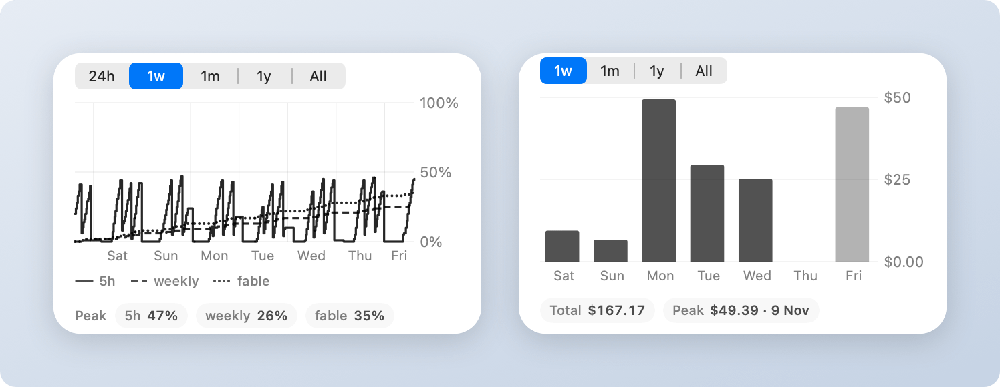

# Tidemark

Your AI usage limits and spend in the menu bar, for every account you use: Claude, OpenAI, Copilot, Cursor, xAI
and more. Native macOS, no dependencies.

<picture>
  <source media="(prefers-color-scheme: dark)" srcset="docs/hero-dark.png">
  
</picture>

- **Every limit at a glance.** Each account's limits as small bars labelled by their window (`5h`, `w`, `mo`…) that
  turn orange, then red, as a limit runs low. Percentages too, or instead, as you like; a balance or spend where there
  are no limits.
- **Compact in the menu bar.** Every account side by side in one item, by provider, or, if you prefer, an item per
  account to ⌘-drag where you like. With accounts of more than one provider, each has a thin line in its provider's
  colour down its left, terracotta for Claude.
- **As many accounts as you use.** Each signs in on its own: personal and work, side by side.
- **The full picture on click.** How much is used, when each limit resets, extra usage, and a history of how it got
  there.
- **API organisations.** What an organisation spent this month and today, and its daily costs.
- **Notifications** as a limit runs low, once per threshold and reset.

## Requirements

- macOS 27 or later
- The Xcode Command Line Tools (`xcode-select --install`)

## Install

```sh
git clone https://github.com/tbgihu/tidemark && cd tidemark && make install
```

This builds Tidemark from source, signs it with a certificate created for this Mac only, and installs it to
`~/Applications/Tidemark.app`. It opens at login; you can turn that off in its settings. Keep the folder you cloned:
Tidemark updates from it.

## Use

- Click Tidemark in the menu bar, then **Add Account…** and a provider, and sign in or paste a key in the sheet that
  opens. Add as many accounts as you like.
- Click an account in the menu bar to see its provider's accounts; every account of that provider lights up there.
  Once you have several providers, the panel has a tab for each: `⌘1`…`⌘9` pick one, `⌃Tab` and `⌃⇧Tab` (or `⌘⇧]`
  and `⌘⇧[`) step through them. Click again, press `Esc` or click elsewhere to close it.
- The gear in the panel opens **Settings**: reorder accounts by dragging, choose what each account shows in the menu
  bar (labels, progress bars, percentages; with neither bars nor percentages, only the panel shows it), give each
  account a menu bar item of its own, choose how often to refresh, turn on notifications, and quit Tidemark.
- Tidemark refreshes every 5 minutes by default. Faster is possible, down to 15 seconds, but providers rate-limit
  frequent polling, and Settings says so below a safe interval. When a provider asks it to slow down, Tidemark waits
  longer.

<picture>
  <source media="(prefers-color-scheme: dark)" srcset="docs/history-dark.png">
  
</picture>

History is Tidemark's own record, kept from the moment you add an account, over 24 hours, a week, a month, a year
or all of it.

## Providers

- **Claude**: accounts' 5-hour (`5h`), weekly (`w(A)`) and weekly Fable (`w(F)`) limits and extra usage; Console
  organisations' costs, with an Admin API key.
- **OpenAI**: ChatGPT accounts' Codex limits (`5h`, `w`) and credits, signed in with a code; API organisations' costs,
  with an Admin API key.
- **Copilot**: monthly premium requests (`mo`), chat and code completion quotas, signed in with GitHub.
- **Cursor**: included usage this billing cycle (`mo`) and on-demand spending, signed in on cursor.com.
- **Antigravity**: each model group's 5-hour and weekly limits (`5h(G)`, `w(G)` for Gemini, `w(C)` for Claude and GPT)
  and AI credits, read through Antigravity's `agy` command line tool. If you use only the Antigravity app, install
  `agy` too and sign in once in Terminal.
- **xAI**: an API team's prepaid credits, spend against its monthly limit (`mo`) and daily costs, with a management
  key.
- **OpenRouter**: a key's spending limit (`day`, `w`, `mo` or `key`) and spend today, this week and this month; the
  credit balance with a management key.
- **Warp**: AI credits used until the next refresh (`mo`) and bonus credits left.
- **DeepSeek**: the account's balance in each currency.
- **Kimi**: Kimi Code's 5-hour, weekly and monthly limits (`5h`, `w`, `mo`); a Moonshot API account's balance.
- **z.ai**: the GLM Coding Plan's 5-hour and weekly limits (`5h`, `w`) and monthly MCP calls (`mcp`).
- **MiniMax**: the Coding Plan's 5-hour and weekly limits (`5h`, `w`), and any other model's windows.
- **Ollama**: Ollama Cloud's included usage (`mo`) and purchased credits.
- **OpenCode**: OpenCode Go's 5-hour, weekly and monthly limits (`5h`, `w`, `mo`), and pay-as-you-go credits: the
  balance left and the last 30 days' spend.
- **ElevenLabs**: credits used this billing period (`mo`) and the subscription's tier.

Unless noted, an account is added with the provider's API key. Costs follow each provider's billing in UTC days and
lag a few hours, so organisations refresh at most every 5 minutes. Admin and management keys carry broad rights,
though Tidemark only reads with them: use a dedicated key with an expiry, and revoke it when you no longer need it.

Each provider is a folder of its own; see [docs/providers.md](docs/providers.md) to add one.

## Updates

Tidemark updates itself from the clone you installed it from, in one of three modes chosen in **Settings → Updates**:

- **Automatically** checks every 2 hours, builds what is new and installs it at once, never during a sign-in.
- **Download Only** checks and builds the same way, then installs when you click **Restart to Update**.
- **Manually** checks only when you click **Check for Updates**.

`make update` in the clone updates at once.

## Privacy and security

Tidemark signs in on its own, in a private browser window or sign-in sheet: it never reads the credentials of other
apps or browsers. It keeps your sign-ins and admin keys in your login keychain, created and read only through Apple's
`/usr/bin/security`, so no rebuild or update ever asks for your password. The trade-off: any process running as you
can read them the same way, as with other command-line tools that keep tokens in the Keychain. While the login
keychain is locked, Tidemark waits and never asks.

It talks only to the providers of the accounts you add and, for updates, to the git remote you cloned from. It
collects nothing and sends nothing anywhere else. See [SECURITY.md](SECURITY.md) for the details.

For several providers, Tidemark reads the same usage endpoints as their own apps. These aren't official, documented
APIs and may change; Tidemark reads them leniently and shows only what it understands, and only values that are still
true: a limit that has reset, or data that is too old, shows no value until Tidemark has read it again.

## Uninstall

```sh
make uninstall
```

removes Tidemark and everything it stored: your accounts' Keychain items, settings, history, the signing identity,
web sign-in sessions, privacy permissions, caches and logs, then this clone, to the Trash. It lists all of it and asks
you to type `uninstall` first. A clone holding work that isn't on GitHub is kept, and it says what. Tidemark's entry
in System Settings › Notifications can only be removed by hand.

## License

[Apache License 2.0](LICENSE). Provider logos are their owners' trademarks; see
[third-party notices](THIRD-PARTY-NOTICES.md).
